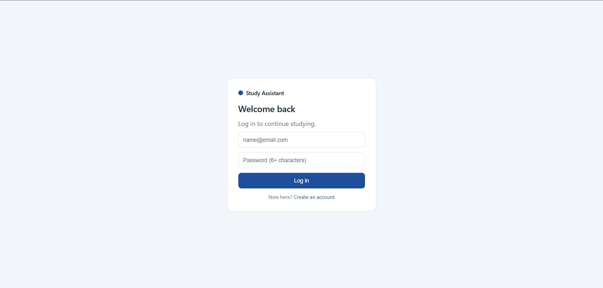
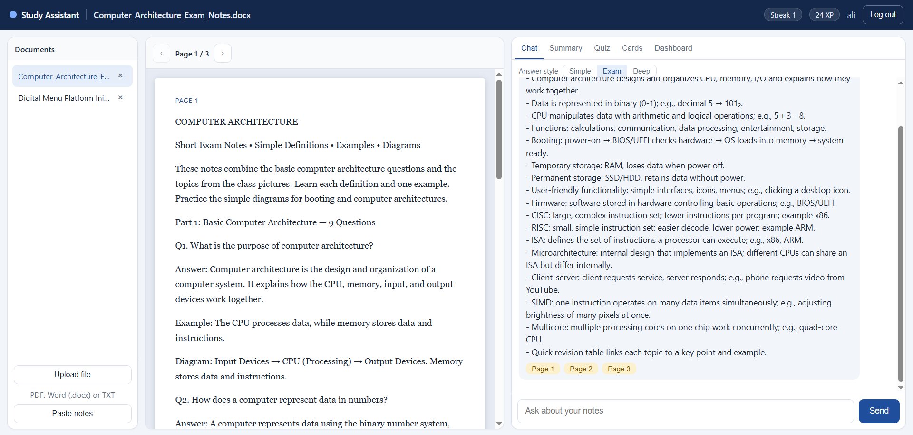
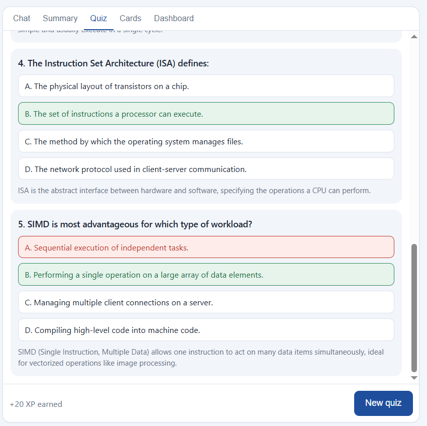
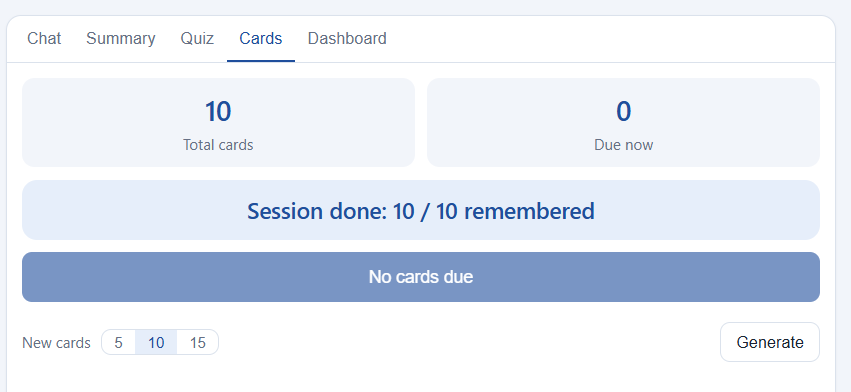
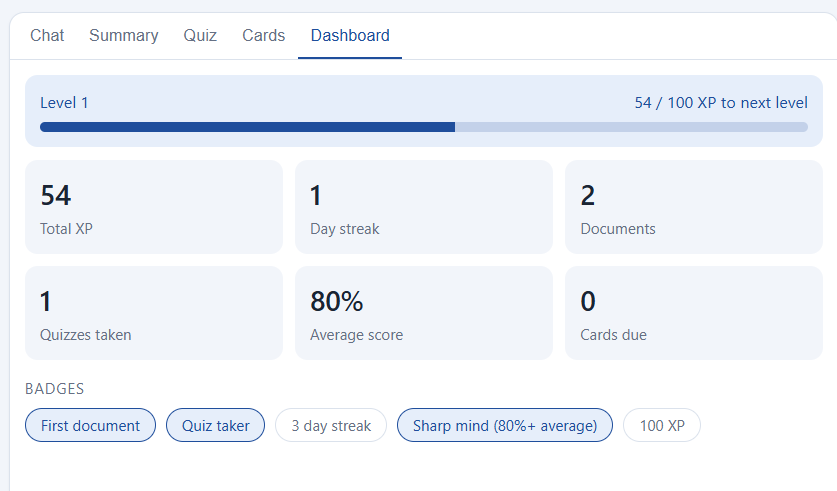
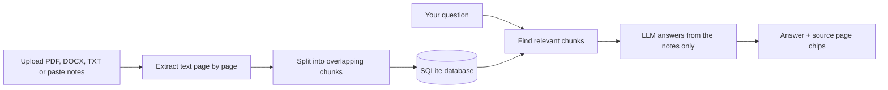
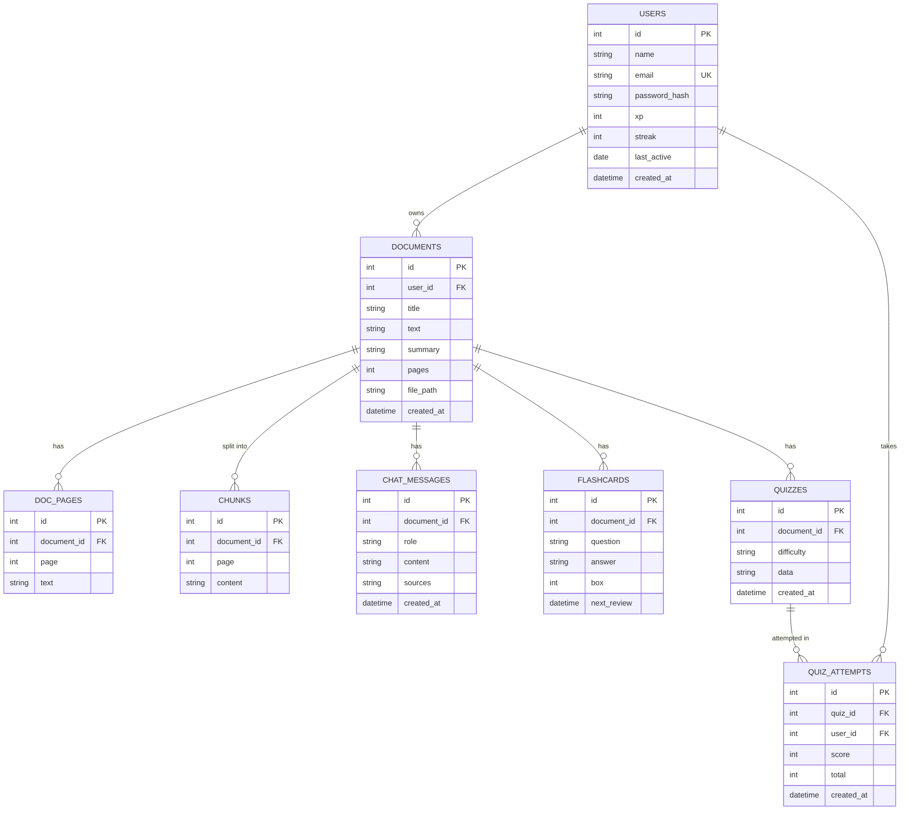

# AI Study Assistant

A web app that turns your notes into a study partner. Upload a PDF, Word file or TXT (or paste notes), then chat with your material and get answers with page references, summaries, quizzes, flashcards with spaced repetition, and a progress dashboard.

**Live demo:** _add your link here_

## Screenshots

| Login | Workspace |
|---|---|
|  |  |

| Quiz | Flashcards | Dashboard |
|---|---|---|
|  |  |  |

## Features

- Sign up and log in with JWT authentication
- Upload PDF, Word (.docx) or TXT files, or paste notes
- Split-view workspace: document on the left, study tools on the right
- Chat with your notes: answers come only from the document, with clickable page chips that jump to the source
- Three answer styles: Simple, Exam, Deep
- Summaries: short, detailed or bullet points
- Quizzes with difficulty levels, instant scoring and explanations
- Flashcards with spaced repetition (missed cards return sooner)
- Dashboard with XP, levels, streaks, quiz average and badges

## Tech stack

| Part | Technology |
|---|---|
| Frontend | React, Vite, PDF.js |
| Backend | Python, FastAPI, SQLAlchemy |
| Database | SQLite |
| AI | Groq API (LLM) |
| Retrieval | TF-IDF similarity (scikit-learn) |
| Auth | JWT, bcrypt password hashing |
| Tests | pytest |

## How it works



1. The text is extracted page by page. Word and pasted notes are split into pages of about 2,800 characters.
2. Pages are split into overlapping chunks and stored.
3. For a question, a short document is sent whole. A longer one uses TF-IDF similarity to pick the 8 best chunks.
4. The LLM is told to answer only from those notes and to report which pages it used. Those pages become the source chips.

Retrieval uses TF-IDF (classic keyword-weighted search). Moving to embeddings with a vector database is the planned upgrade.

## Database design (ERD)



## API overview

Interactive docs are available at `/docs` when the backend is running.

| Method | Endpoint | Purpose |
|---|---|---|
| POST | `/auth/signup`, `/auth/login` | Create account, log in |
| GET | `/auth/me` | Current user |
| POST | `/documents/upload`, `/documents/paste` | Add a document |
| GET | `/documents`, `/documents/{id}` | List and open documents |
| GET | `/documents/{id}/pages`, `/documents/{id}/file` | Page text, original PDF |
| DELETE | `/documents/{id}` | Delete a document |
| POST | `/documents/{id}/summary` | Generate a summary |
| POST, GET | `/documents/{id}/chat` | Ask a question, chat history |
| POST | `/documents/{id}/quiz` | Generate a quiz |
| POST | `/quizzes/{id}/submit` | Submit answers, get score |
| POST, GET | `/documents/{id}/flashcards` | Generate and list cards |
| POST | `/flashcards/{id}/review` | Review a card |
| GET | `/dashboard` | Progress stats |

## Run it locally

You need Python 3.12 or newer, Node.js 18 or newer, and a free [Groq](https://console.groq.com) API key.

**Backend**

```bash
cd backend
python -m venv venv
venv\Scripts\activate
pip install -r requirements.txt
```

Create `backend/.env`:

```
GROQ_API_KEY=your_key_here
GROQ_MODEL=openai/gpt-oss-120b
SECRET_KEY=any-long-random-text
```

```bash
uvicorn main:app --reload
```

**Frontend** (new terminal)

```bash
cd frontend
npm install
npm run dev
```

Open http://localhost:5173.

## Tests

```bash
cd backend
pip install pytest httpx
pytest -v
```

The tests use an in-memory database and fake AI answers, so they need no API key.

## Environment variables

| Variable | Where | Purpose |
|---|---|---|
| `GROQ_API_KEY` | backend | Groq API key |
| `GROQ_MODEL` | backend | Model name |
| `SECRET_KEY` | backend | Signs login tokens |
| `VITE_API_URL` | frontend | Backend URL (default `http://127.0.0.1:8000`) |

## Project structure

```
ai-study-assistant/
├── backend/
│   ├── main.py          # API routes
│   ├── models.py        # database tables
│   ├── database.py      # database connection
│   ├── auth.py          # JWT and password hashing
│   ├── ai.py            # LLM calls, chunking, retrieval
│   ├── readers.py       # Word and text to pages
│   ├── test_app.py      # tests
│   └── requirements.txt
├── frontend/
│   └── src/
│       ├── App.jsx       # login and app shell
│       ├── Workspace.jsx # split-view screen
│       ├── TabContent.jsx# summary, quiz, cards, dashboard
│       ├── Viewers.jsx   # PDF and text viewers
│       └── api.js        # backend calls
└── README.md
```

## Known limitations

- Scanned PDFs (images of text) are not supported yet; they need OCR.
- Old `.doc` files are not supported. Save them as `.docx`.
- Word files have no real pages, so they are split into virtual pages.
- Free hosting may reset the SQLite database when the server restarts.

## Future work

- Embeddings and a vector database for retrieval
- OCR for scanned PDFs
- Weak-topic analytics, mind maps and a study planner

## Author

Ali Asif, BSCS, NCBA&E Lahore. [GitHub](https://github.com/ITz-ALI-CS)